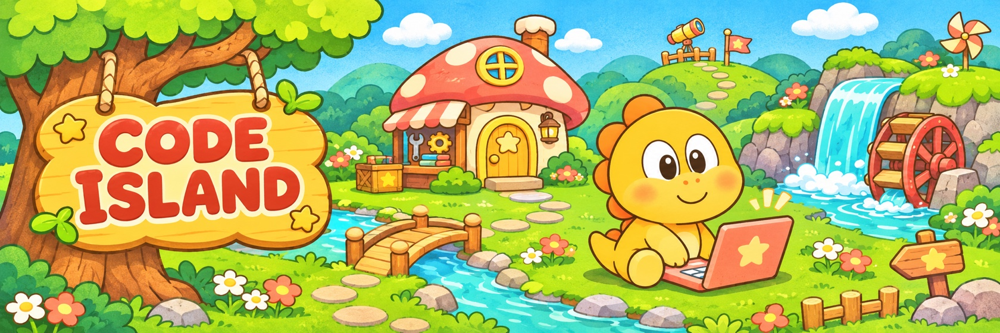
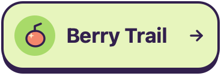
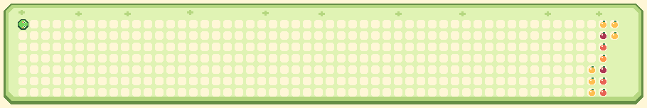

<!-- Hallmark · pre-emit critique: P5 H5 E4 S5 R4 V5 -->
<picture><source media="(prefers-reduced-motion: no-preference)" srcset="https://raw.githubusercontent.com/MrMilkDragon/MrMilkDragon/main/island/code-island-motion.png"></picture>

## Hi, I'm MrMilkDragon!

[**AI Phone**](https://github.com/MrMilkDragon/AI-Phone) · An Android phone and a Linux desktop for AI agents.

  <a href="https://github.com/MrMilkDragon?tab=repositories"><picture><source media="(prefers-reduced-motion: no-preference)" srcset="https://raw.githubusercontent.com/MrMilkDragon/MrMilkDragon/main/island/workshop-motion.png"></picture></a>
  <a href="https://github.com/MrMilkDragon?tab=stars"><picture><source media="(prefers-reduced-motion: no-preference)" srcset="https://raw.githubusercontent.com/MrMilkDragon/MrMilkDragon/main/island/star-pond-motion.png"></picture></a>
  <a href="#berry-trail"><picture><source media="(prefers-reduced-motion: no-preference)" srcset="https://raw.githubusercontent.com/MrMilkDragon/MrMilkDragon/main/island/berry-button-motion.png"></picture></a>

### Berry Trail

<picture><source media="(prefers-reduced-motion: no-preference)" srcset="https://raw.githubusercontent.com/MrMilkDragon/MrMilkDragon/main/island/berry-trail-motion.png"></picture>
